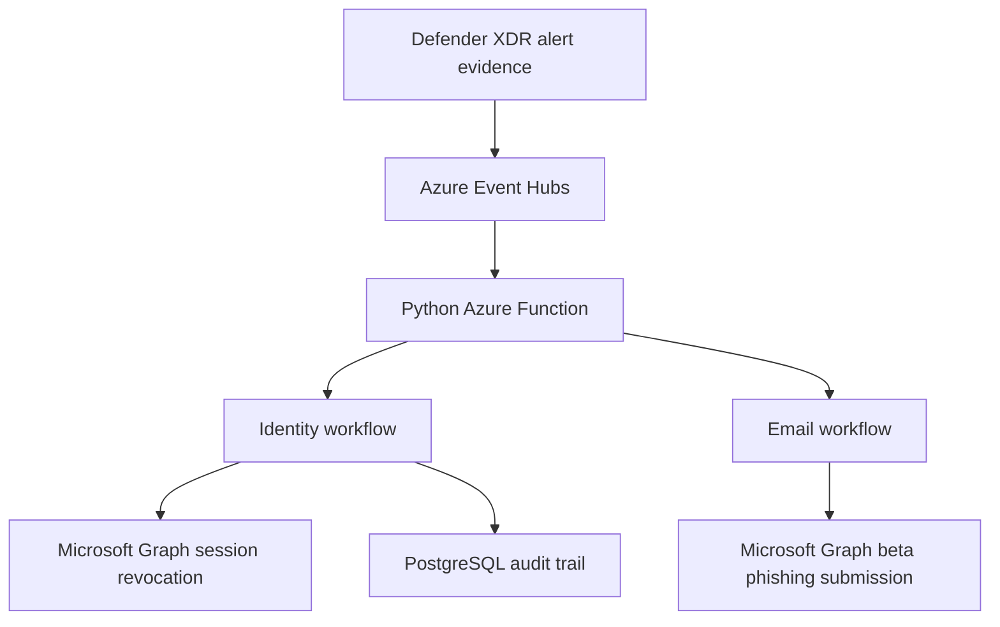

# Microsoft 365 Alert Response with Azure Functions

A Python prototype for teams that want to automate selected Microsoft 365 alert responses without relying on Microsoft Sentinel playbooks. It consumes Defender XDR alert evidence through Azure Event Hubs, routes matching records, and uses Microsoft Graph for response actions.



## Current scope

| Workflow | Behavior | Validation |
| --- | --- | --- |
| Identity | Routes selected high-severity alert titles, looks up account and risk information, and can revoke sign-in sessions. | Session revocation manually verified. |
| Audit | Records a revocation attempt before calling Graph and updates the same row with the outcome. | PostgreSQL insert and update manually verified. |
| Email | Routes the configured spoofed-mail title, looks up the message by Internet Message ID, and submits it to Microsoft for analysis. | Implemented. Live mailbox lookup and submission still need end-to-end validation. |

Phishing submission and email removal are separate actions. This email workflow submits a report for analysis. Defender already has response actions for removal. This augments that and reports it to Microsoft

## Run locally

1. Use a test Microsoft Entra tenant and test accounts. Install Python and Azure Functions Core Tools. Start Azurite if you use local Functions storage emulation.
2. Install dependencies from the project root:

   ```powershell
   python -m pip install -r requirements.txt
   python -m pip check
   ```

3. Configure the settings below in the `Values` section of a private `local.settings.json`. For Azure deployment, configure equivalent Function App settings.
4. Create the `public.identity_response_audit` table in PostgreSQL using the project's audit schema. Use a database account with access to insert and update audit records.
5. Run `func start` from the project root. Use a dedicated test Event Hub and synthetic alerts. Test matching separately before sending events that can revoke sessions or submit email reports.

| Setting | Purpose |
| --- | --- |
| `FUNCTIONS_WORKER_RUNTIME` | Set to `python`. |
| `AzureWebJobsStorage` | Functions host storage. Use `UseDevelopmentStorage=true` when running Azurite locally. |
| `EventHubConnection` | Connection setting for the Event Hub trigger. Check the hub name in the trigger decorator. |
| `TenantID`, `ClientID`, `ClientSecret` | Microsoft Entra app registration credentials. |
| `POSTGRES_CONNECTION_STRING` | PostgreSQL connection string for the audit database. |

Use admin-consented Microsoft Graph application permissions for the workflows you enable. The email workflow needs a provisioned Exchange Online test mailbox containing the target message. Keep credentials, real alert payloads, and `local.settings.json` out of Git.

## Response rules and audit behavior

The function parses each event once and evaluates its `AdvancedHunting-AlertEvidence` records against criteria grouped by workflow. Identity routing uses alert title and severity. Email routing uses the configured title and reads the recipient and message identifiers from the outer record.

The audit table stores an attempt ID, alert and user identifiers, timestamps, and the action outcome. An unconfirmed Graph response can be recorded as `unknown`. Attempt IDs track individual executions. Duplicate events or retries can still cause repeated actions, so use this as a lab prototype.


